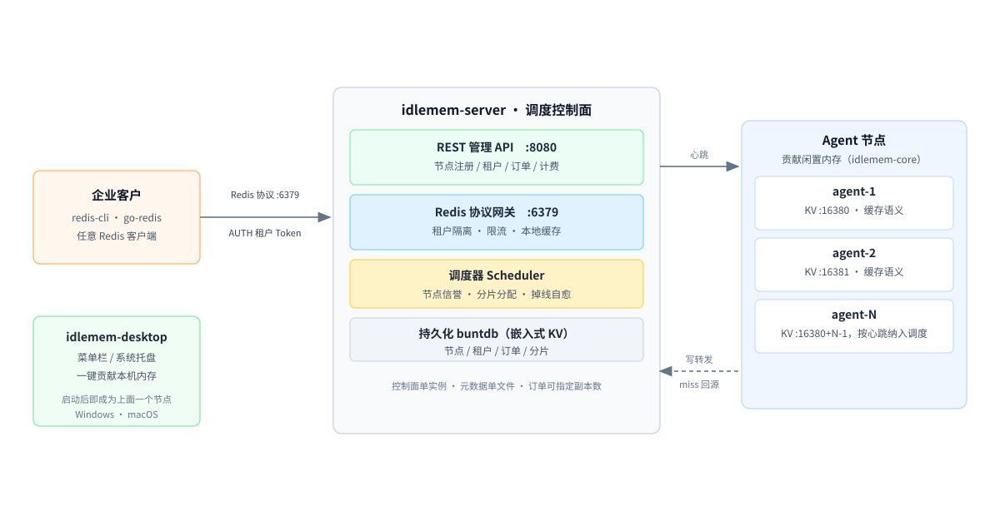

# idlemem-core

> 闲存云（XianCun Cloud）Agent 核心库 —— 把闲置电脑内存变成可收益资源的跨平台 Go 库。

**闲存云**把个人与中小机房闲置的内存聚成一个分布式 KV 缓存池，本仓库是其中的**贡献节点核心库**。配套的两个仓库：[idlemem-server](https://github.com/renzhiyong1680-code/idlemem-server)（调度控制面，Redis 协议网关在此）、[idlemem-desktop](https://github.com/renzhiyong1680-code/idlemem-desktop)（Windows 托盘 / macOS 菜单栏外壳）。

项目定位、**明确不做什么**、当前进度与关键参数，集中在 [项目介绍](https://github.com/renzhiyong1680-code/idlemem-core/blob/master/docs/%E9%A1%B9%E7%9B%AE%E4%BB%8B%E7%BB%8D.md)。第一次接触这个项目，建议先读那篇。

`idlemem-core` 是一个**零第三方依赖、跨平台（Windows / Linux / macOS）**的 Go 核心库，用于构建"闲置内存贡献节点"（Agent）。它负责：采集系统内存 → 计算可安全贡献的容量（保底预留 + 高负载缩容 + 迟滞防抖）→ 提供带 TTL 的内存 KV 引擎 → 周期上报心跳到平台控制面。

各端外壳程序（Windows 托盘、macOS 菜单栏、Linux 守护进程）只需嵌入本库，即可获得完整的贡献节点能力。

## 三仓如何协作



一次请求的走向：企业客户用任意 Redis 客户端连 `idlemem-server` 的网关（`:6379`）并 `AUTH` 租户 Token → 控制面把订单容量切成小分片，按节点信誉分配给各 Agent → Agent 由本库驱动，把闲置内存作为带 TTL 的 KV 提供（`:16380`）→ 网关写入时转发到所有在线分片节点，本地 miss 时回源。`idlemem-desktop` 是让普通用户一键成为节点的外壳。

不想先编译？`idlemem-server` 仓提供了一条命令跑起整套系统的脚本（Windows 一条命令，或 `docker compose up`），见 [那里 README 的「快速起步」](https://github.com/renzhiyong1680-code/idlemem-server#%E5%BF%AB%E9%80%9F%E8%B5%B7%E6%AD%A5)。

## 特性

- ✅ **零第三方依赖**：仅使用 Go 标准库与操作系统原生接口，`go mod tidy` 无任何外部包
- ✅ **跨平台**：Windows（`GlobalMemoryStatusEx`）、Linux（`/proc/meminfo`）、macOS（`sysctl` + `vm_stat`）
- ✅ **智能贡献治理**：保底预留内存、使用率阈值缩容、迟滞区间防抖（`governor`）
- ✅ **内存 KV 引擎**：分片锁 + 惰性过期 + 数据拷贝隔离，并发安全（`kvstore`）
- ✅ **心跳上报**：接口化设计，内置 HTTP/JSON 参考实现，可替换 gRPC/WebSocket（`heartbeat`）
- ✅ **稳定节点 ID**：基于主机名 + 网卡 MAC 哈希，跨重启不变（`nodeid`）
- ✅ **完整生命周期**：启动/停止/容量回调，示例程序可直接跑通（`agent` + `examples/basic`）

## 架构

```
┌──────────────────────────────────────────────────────┐
│                 外壳程序（各端各自实现）                │
│   Windows 托盘 · macOS 菜单栏 · Linux systemd 服务     │
├──────────────────────────────────────────────────────┤
│                  idlemem-core（本库）                  │
│                                                      │
│   agent（整合入口：生命周期 / 容量决策 / 心跳调度）      │
│     ├── meminfo    内存采集（跨平台）                  │
│     ├── governor   贡献治理（预留 / 缩容 / 迟滞）       │
│     ├── kvstore    内存 KV 引擎（TTL / 分片锁）        │
│     ├── kvsrv      RESP KV 服务器（最小 Redis 协议）   │
│     ├── heartbeat  心跳上报（接口 + HTTP 实现）        │
│     └── nodeid     节点 ID 生成                       │
├──────────────────────────────────────────────────────┤
│               调度控制面（平台侧，另建）                │
└──────────────────────────────────────────────────────┘
```

## 快速开始

```bash
# 运行示例程序（每 2 秒采样内存、计算贡献容量、打印心跳）
go run ./examples/basic
```

示例输出：

```
idlemem-core demo, node=a512c2fde7be0a23, version=0.1.0
[capacity] 0 -> 12011229184 bytes
[heartbeat] status=online capacity=12011229184 bytes used=0 bytes sys_used=52.3% uptime=0s
```

## Agent 可运行外壳（`cmd/xiancun-agent`）

仓库自带一个**零依赖、可直接运行**的 Agent 外壳：把核心库装配成真正的"贡献节点"进程，既上报心跳到控制面，又暴露一个**最小 Redis 协议 KV 端口**，供企业客户端或平台网关存取缓存。

```bash
# 本机运行（默认连 http://127.0.0.1:8080，KV 端口 :16380）
go run ./cmd/xiancun-agent

# 指定控制面与 KV 端口
go run ./cmd/xiancun-agent -server http://1.2.3.4:8080 -kv :16380 -interval 10s

# 用 JSON 配置文件
go run ./cmd/xiancun-agent -config agent.json

# 交叉编译到 Linux（云主机） / macOS
GOOS=linux  GOARCH=amd64 go build -o xiancun-agent-linux  ./cmd/xiancun-agent
GOOS=darwin GOARCH=amd64 go build -o xiancun-agent-macos ./cmd/xiancun-agent
```

配置字段（JSON）：

| 字段 | 说明 | 默认 |
|---|---|---|
| `server` | 控制面 REST API 地址 | `http://127.0.0.1:8080` |
| `kv_addr` | KV 服务监听地址（Redis 协议） | `:16380` |
| `node_id` | 节点 ID，空则自动生成稳定 ID | 自动 |
| `interval` | 心跳上报间隔（纳秒） | `10s` |
| `kv_max_bytes` | KV 引擎容量上限，0 由治理器动态决定 | `0` |

KV 端口支持命令：`PING / SET [EX] / GET / DEL / EXPIRE / TTL / INFO / QUIT`。写入会受治理器容量约束（超出当前可贡献容量返回 `ERR out of capacity`），`used_bytes` 随心跳上报控制面。

### 启动前自检（`-check`）

供给端最常见的失败不是进程起不来，而是起来了却没人能连上：端口被占、控制面地址写错、节点令牌没配、NAT 没做映射。这些在启动后才暴露，日志里也不容易看出来，所以做了一条能单独跑的检查命令：

```bash
xiancun-agent -check -server http://1.2.3.4:8080 -kv :16380 -node-token "$NODE_TOKEN"
```

它依次检查并给出结论：

| 检查项 | 判定方式 | 失败时的常见原因 |
|---|---|---|
| 内存与可贡献容量 | 采集本机内存 + 治理器算可贡献量 | 可用内存低于保底预留（不阻塞启动，空闲后自动恢复） |
| KV 端口可监听 | **先 dial 探活再 Listen** | 端口已被旧进程占用；Windows 上仅 Listen 会把占用误判为成功 |
| 控制面心跳上报 | 真发一次心跳 | 地址不通（连接被拒/超时）、服务端开了节点鉴权但令牌不对（401） |

退出码 `0` 表示全部通过、可以启动；`1` 表示有项未通过，输出里已给出对应建议。部署脚本与运维巡检可以直接用退出码判断。

公网可达性无法在本机自证（网关是从公网回连 `kv_addr` 的），需要在另一台机器或手机热点网络上用 `xiancun-client -addr <公网地址>:<端口> ping` 验证，能返回 `PONG` 才说明 NAT/端口映射真的通。

## 嵌入指南（三步接入）

```go
package main

import (
    "context"
    "time"

    "github.com/renzhiyong1680-code/idlemem-core/agent"
    "github.com/renzhiyong1680-code/idlemem-core/governor"
    "github.com/renzhiyong1680-code/idlemem-core/heartbeat"
    "github.com/renzhiyong1680-code/idlemem-core/meminfo"
    "github.com/renzhiyong1680-code/idlemem-core/nodeid"
)

func main() {
    // 1. 生成稳定节点 ID
    id, _ := nodeid.Generate()

    // 2. 组装 Agent：真实内存源 + 默认治理策略 + 心跳上报到平台端点
    a, err := agent.New(agent.Config{
        NodeID:         id,
        MemProvider:    meminfo.SystemProvider{},
        GovernorCfg:    governor.DefaultConfig(),
        Reporter:       heartbeat.NewHTTPReporter("https://platform.example.com/heartbeat"),
        ReportInterval: 10 * time.Second,
        CapacityChangeCb: func(old, new uint64) {
            // 容量变化时通知 KV 服务调整（例如缩容时拒绝新写入）
        },
    })
    if err != nil {
        panic(err)
    }

    // 3. 启动，ctx 取消即优雅停止
    ctx, cancel := context.WithCancel(context.Background())
    defer cancel()
    a.Start(ctx)
    select {}
}
```

## 部署（Linux / systemd）

生产环境一键部署见 [`deploy/`](deploy/)（systemd 单元 + 配置模板 + 安装/卸载脚本）：

```bash
sudo ./deploy/install-agent.sh --binary ./xiancun-agent-linux --server http://server.example.com:8080
```

## 包说明

| 包 | 职责 |
|---|---|
| `agent` | 整合入口：依赖装配、后台循环（采样→决策→上报）、生命周期、容量回调 |
| `meminfo` | 跨平台物理内存快照（Total / Available / Used / UsedPct） |
| `governor` | 计算可贡献容量：保底预留、高水位缩容、低水位恢复、迟滞防抖 |
| `kvstore` | 纯内存 KV 引擎：分片锁、TTL 惰性过期、值拷贝隔离、容量统计与上限检查（`CanFit`）、TTL 查询（`TTL`） |
| `heartbeat` | 心跳数据模型 + 上报接口；内置 HTTP/JSON 实现（可替换） |
| `nodeid` | 基于主机指纹的稳定节点 ID |
| `cmd/xiancun-agent` | Agent 可运行外壳：心跳上报 + Redis 协议 KV 服务（零依赖） |

## 测试

```bash
go vet ./...
go test ./... -count=1          # 单元测试
go test ./... -race -count=1    # 竞态检测（Windows 需安装 gcc 以启用 cgo）
```

覆盖场景：治理迟滞状态机、KV 并发读写、TTL 过期、值隔离、心跳上报（httptest 模拟服务端）、Agent 高负载挂起与恢复。

## 许可证

本项目采用 **GNU Affero General Public License v3.0**（AGPL-3.0）授权，全文见 [LICENSE](LICENSE)。

- **网络服务义务**：任何通过网络向他人提供本项目（或其修改版）服务的部署，都必须向使用者提供对应的完整源码。
- **商业授权**：如需在闭源产品中集成，或需要免除 AGPL-3.0 的开源义务，可另行取得商业授权，细则见 [COMMERCIAL.md](COMMERCIAL.md)。
- **历史版本**：`v0.1.0` 及更早版本按 MIT 许可证发布，该授权不可撤销；AGPL-3.0 自 `v0.1.1` 起适用。

## 贡献

本项目采用 AGPL-3.0 与商业授权并行的双许可模式，因此对贡献的权利链有明确要求。提交拉取请求前，请阅读 [CLA.md](CLA.md)，并在 PR 模板中勾选确认。

- 贡献者保留自己贡献的著作权，仅授予项目方永久、全球、免费的许可，允许项目方在开源与商业授权两种模式下使用。
- 未确认 CLA 的拉取请求不会被合并。
- 提交前请先开 Issue 说清要解决的问题，避免大改动方向不符。

---

**闲存云 · 把闲置的内存变成可收益的资源**
