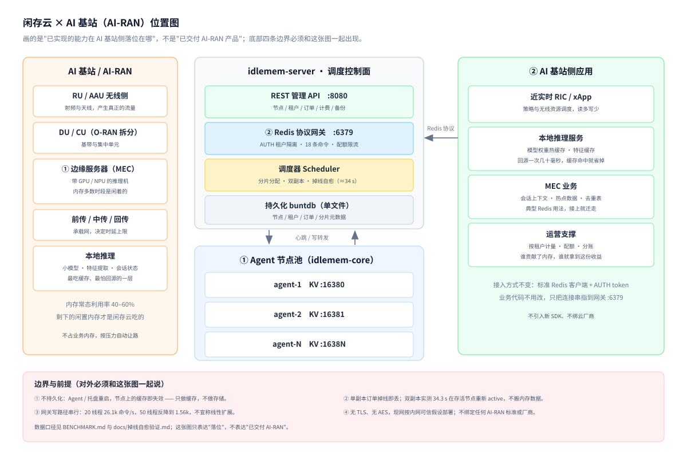

# 闲存云（XianCun Cloud）项目介绍

> 把个人和中小机房长期闲置的内存，聚成一个程序可以直接使用的分布式 KV 缓存池。

本文是整个项目的总说明。三个仓库各自的技术细节见各自的 README，这里只回答四件事：这是什么、解决什么问题、**明确不做什么**、现在到哪一步了。

## 一、这是什么

一台 16 GB 内存的电脑，日常真正用到的往往不到一半。大量个人电脑、家用 NAS、闲置服务器、小型机房的机器，内存常年空着一半以上。

闲存云做的事很直接：在这些机器上各划出一块受控的内存区域，注册成缓存节点；需要缓存的应用通过一个统一的 Redis 协议入口读写数据；平台按实际占用的 GB·小时向供需两侧分别计量结算。

对供给方，闲置内存从"空着"变成"有结算"；对需求方，不必为峰值容量买断机器，也不必为闲时付费。

## 二、解决什么问题

企业做缓存时的典型处境：

- 自建 Redis：要买机器、要专人运维、要按峰值容量铺资源，闲时资源白放着；
- 云上托管 Redis：按规格计费，账单和实际用量经常对不上；
- 弹性伸缩：扩容要时间，缩容要改架构，做起来都不轻松。

而供给侧的闲置内存是现成的、已经在通电的、已经付过电费的。

闲存云要做的就是把这两边接起来，让"多出来的内存"和"临时需要的内存"能按小时结算地撮合。

## 三、明确不做什么

这一节比"能做什么"更重要，因为它决定了这个项目的技术前提。

**不做"远程聚合大内存"。**

跨公网的家用节点，网络延迟是毫秒级的随机抖动，不是稳定的微秒级；节点随时可能掉线、休眠、切网、被用户关机。把这样一批节点当成一块远端 RAM 来用，任何依赖低延迟或强一致性的场景都会失败——而且失败往往是无声的，读到的不是旧数据就是未命中。

所以本项目只提供 **Best-Effort 的分布式 KV 缓存**语义：

- 所有数据带 TTL，到期即失效，没有"永久保存"这回事；
- 支持多副本，但副本之间不保证强一致，只提供"尽力而为"的可用性；
- 节点掉线时，其上的分片进入 lost 状态，调度把请求转到存活副本；无副本可转则按未命中处理；
- **不承诺持久化**，进程重启、机器关机，数据就没了。

**这意味着：不要用它存不可重建的数据。** 缓存未命中就回源，是这个系统的设计前提，不是需要修的缺陷。如果你的业务要求"像本地内存一样快"或"写进去绝不丢"，请直接用本地 Redis 或托管服务，本项目不适合。

## 四、三个仓库怎么配合

| 仓库 | 角色 | 关键能力 |
|---|---|---|
| [`idlemem-core`](https://github.com/renzhiyong1680-code/idlemem-core) | 贡献节点的核心库 | 跨平台内存探测、贡献量治理（保底预留 + 高负载缩容 + 迟滞防抖）、带 TTL 的内存 KV 引擎、RESP 协议最小服务器、心跳上报、稳定节点 ID |
| [`idlemem-server`](https://github.com/renzhiyong1680-code/idlemem-server) | 平台后端 / 调度控制面 | 节点注册与心跳、分片调度、掉线自愈迁移、租户与订单管理、Redis 协议网关、REST 管理 API、三档计量 |
| [`idlemem-desktop`](https://github.com/renzhiyong1680-code/idlemem-desktop) | 供给侧的桌面外壳 | Windows 系统托盘 / macOS 菜单栏，一键暂停恢复贡献，实时显示贡献容量与占用 |

一条请求的走向：应用的 Redis 客户端连到 server 的网关，网关按分片找到持有该键的节点，把命令转发过去，节点在自己的内存里读写后返回。

## 五、现在能做到什么

- **协议兼容**：网关按 Redis 协议（RESP）通信，标准 Redis 客户端可直接接入，使用前需 AUTH 租户令牌；命令集覆盖日常读写所需的 18 条（`AUTH` `PING` `SET [EX]` `SETEX` `GETSET` `APPEND` `STRLEN` `TYPE` `GET` `DEL` `EXISTS` `MGET` `MSET` `INCR` `EXPIRE` `TTL` `INFO` `QUIT`），完整清单见 server README。
- **节点治理**：节点注册、心跳上报、超时判定（30 秒无心跳即视为离线）、可贡献容量计算。容量算法带保底预留和高负载自动缩容，避免把机器主人自己的内存吃掉。
- **调度与容错**：分片按活跃节点分配，副本数可由请求指定，省略时取配置默认值（默认 1）。节点掉线后分片在 `active` / `degraded` / `migrating` 之间迁移，`lost` 分片不计入容量承诺。
- **计量出账**：三档计量——`node`（节点维度）、`node_used`（供给结算依据）、`tenant`（客户计费依据），默认每 60 秒采样一次。
- **零门槛贡献**：桌面托盘程序装上就能贡献内存，不用开命令行。

## 六、现在还做不到什么

诚实列出，避免误用：

- **控制面是单实例**。没有多副本、没有水平扩展，控制面挂掉整个平台不可用。多控制面属于下一阶段。
- **没有跨区域调度**。节点和客户的地理位置不参与决策，跨省访问的延迟不受控制。
- **没有 SLA**。本版不提供任何可用性承诺，不要据此安排生产计划。
- **命令集不完整**。不支持 `SCAN` / `KEYS` / `SETNX` / `INCRBY` / `DECR` / `DECRBY` / `LPUSH`；依赖这些命令的客户端或框架会报错。
- **数据不持久化**。进程重启即清空，设计如此。
- **没有可视化控制台**。节点、租户、订单的管理都走 REST API。

## 七、关键参数

| 项 | 值 |
|---|---|
| 控制面 REST API | `:8080` |
| Redis 协议网关 | `:6379` |
| Agent KV 端口 | `:16380` |
| 心跳超时 | 30 秒 |
| 分片淘汰（EvictAfter） | 24 小时 |
| 计量采样间隔 | 60 秒 |
| 元数据存储 | buntdb 单文件（进程工作目录下的 `idlemem-server.db`） |

## 八、当前状态

`v0.1.1`，MVP 阶段。

"节点贡献 → 调度分配 → 客户端读写 → 计量出账"这条完整链路已经跑通，可以自己搭一套评估、可以做小规模试用。但代码和设计仍在快速变化，不适合直接承载生产流量，也不适合放进对可用性有要求的场景。

`v0.1.1` 与 `v0.1.0` 的代码完全一致，本版只变更了许可证（MIT → AGPL-3.0）。

## 九、许可与商业

- **开源许可**：AGPL-3.0。可自由使用、修改、分发，包括商业用途；但一旦以网络服务形式对外提供，须按第 13 条向使用者提供完整源码。
- **商业授权**：需要闭源集成、或需要免除开源义务时另行取得，条款见各仓 [`COMMERCIAL.md`](https://github.com/renzhiyong1680-code/idlemem-core/blob/master/COMMERCIAL.md)。
- **历史版本**：`v0.1.0` 及更早按 MIT 发布，该授权不可撤销。
- **外部贡献**：须先同意 [`CLA.md`](https://github.com/renzhiyong1680-code/idlemem-core/blob/master/CLA.md)，贡献者保留著作权，仅授予项目方在开源与商业两种模式下使用的许可。

## 十、从哪里开始

| 你的目标 | 从这走 |
|---|---|
| 贡献闲置内存 | 装 `idlemem-desktop` 的托盘程序，或直接跑 core 里的 `xiancun-agent` |
| 接入缓存 | 部署 `idlemem-server`，用任意 Redis 客户端连 `:6379` |
| 读代码 / 参与开发 | 三个仓库的 README 都有架构图和运行方式；改动前请先开 Issue |
| 商业合作 | 见 `COMMERCIAL.md`，说明使用场景、实例数量、是否需要闭源与技术支持 |

## 十一、附：和 AI 基站（AI-RAN）是什么关系

**一句话（配图用，50 字）**：闲存云把 AI 基站边缘服务器上闲着的内存聚成 Redis 兼容缓存池，让本地推理和 RIC 应用就近取数，不占业务内存。

这不是"我们要做 AI-RAN"，而是"AI 基站这个场景里，哪一层正好是闲存云能补的"。具体落位三处：

| 落位 | 为什么成立 | 依据 |
|---|---|---|
| 边缘服务器装 Agent | 带 GPU/NPU 的推理机内存常态利用率 40–60%，剩下的是闲着的；Agent 有保底预留和高负载缩容，不会抢业务内存 | core 的 `governor`、`meminfo` 与 desktop 托盘的暂停/恢复 |
| 应用零改造接入 | 用的是标准 Redis 协议，现有 RIC/xApp、推理服务、MEC 业务只改连接串，不引入新 SDK | 网关 18 条命令，见 server README |
| 供需计量分账 | 谁贡献了内存谁拿这份收益，基站/机房侧可以按节点维度结算 | 三档计量 `node` / `node_used` / `tenant` |

**边界，必须一起说**（图上也有）：

- 只做缓存不做存储：Agent 或托盘重启，节点上的缓存即失效；
- 单副本订单掉线即丢；双副本实测 34.3 秒在存活节点重新 `active`，迁移只重排所有权、**不搬内存数据**；
- 网关写路径串行：20 线程 26.1k 命令/s，50 线程反降到 1.56k，不宣称线性扩展；
- 无 TLS、无 AES，只在可信内网假设下部署；
- 不绑定任何 AI-RAN 标准或厂商，也不算 AI-RAN 产品交付。
